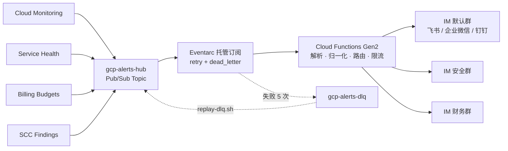

# GCP 全方位告警转发 IM 机器人（飞书 / 企业微信 / 钉钉）

[English](README_EN.md) | 简体中文

把 Google Cloud 的四个数据源 —— **Cloud Monitoring 指标告警、Personalized Service Health 服务健康事件、Cloud Billing 预算超支、Security Command Center 安全发现** —— 统一转成 IM 群机器人卡片。支持 **飞书/Lark、企业微信、钉钉** 三个平台，**每次部署三选一**（单平台：default / security / billing 三类告警都发往同一个平台）。

10 分钟部署，月成本 < $0.50，无常驻资源。

> 函数名 `gcp-alerts-to-feishu`、通知渠道 `Feishu Alert Hub`、Secret `feishu-*`、state bucket `<项目>-gcp-feishu-tfstate` 等名称中的 feishu 均为**历史命名，与所选渠道无关**，为兼容存量部署保留，选企业微信 / 钉钉时同样沿用。



---

## 前置条件

- 一个 GCP 项目，当前身份具备 `roles/editor` **加** `roles/resourcemanager.projectIamAdmin`（editor 不含 `setIamPolicy`，脚本要给函数 SA 和服务代理授权）。不能发 editor的环境，按[完整指南的最小角色集](docs/full-guide.md#所需-iam-权限)授予。
- 所选平台的一个群机器人 Webhook URL（**分步创建教程见 [docs/bot-setup.md](docs/bot-setup.md)**，要点见下文[选择通知渠道](#选择通知渠道三选一)）：
  - **飞书/Lark**：用飞书电脑版→群设置 → 群机器人 → 添加机器人 → 自定义机器人。**签名密钥**：机器人开了"签名校验"就填那串密钥，没开则填字符串 `NONE`（留空会被拒绝）。
  - **企业微信**：群机器人（消息推送）的 Webhook，无签名。
  - **钉钉**：自定义机器人的 Webhook + 加签密钥（未开加签填 `NONE`）。
- 本地部署需已安装并登录 `gcloud`；走 Cloud Shell 则无需任何本地安装。

---

## 快速部署

两条路径**功能对等**（同样的 topic / DLQ / 函数配置 / 四个数据源 / 最小权限模型），差别只在生命周期管理。**不要同时用两条** —— 资源名相同，会争夺所有权。

不带 `--project` 时脚本会列出你有权限的项目让你选，只在本次运行内生效，**不会改写你的 `gcloud` 默认配置**。

### 选择通知渠道（三选一）

每次部署只对接**一个** IM 平台。交互模式下脚本先出菜单：

```
请选择通知渠道（每次部署只能选一个，default/security/billing 三类告警都发往该平台）：
  1) 飞书/Lark
  2) 企业微信
  3) 钉钉
输入编号 [1]:
```

非交互（`--yes` / CI）改从环境变量读取，`NOTIFY_CHANNEL` 未设置时为 `feishu`（函数已存在时沿用线上渠道）：

```bash
# 飞书/Lark（未开签名校验时 FEISHU_SECRET=NONE）
NOTIFY_CHANNEL=feishu FEISHU_WEBHOOK='https://open.feishu.cn/open-apis/bot/v2/hook/xxx' FEISHU_SECRET=NONE \
  ./deploy-gcloud.sh --project=my-proj --region=asia-east1 --yes

# 企业微信（无签名，只需 webhook）
NOTIFY_CHANNEL=wecom WECOM_WEBHOOK='https://qyapi.weixin.qq.com/cgi-bin/webhook/send?key=xxx' \
  ./deploy-gcloud.sh --project=my-proj --region=asia-east1 --yes

# 钉钉（推荐加签：填 SEC 开头的密钥；未开加签填 NONE）
NOTIFY_CHANNEL=dingtalk DINGTALK_WEBHOOK='https://oapi.dingtalk.com/robot/send?access_token=xxx' DINGTALK_SECRET='SECxxx' \
  ./deploy-gcloud.sh --project=my-proj --region=asia-east1 --yes
```

`deploy-terraform.sh` 读同一组变量，并把 `notify_channel = "<渠道>"` 写入 `terraform.tfvars`。

### 路径 1：gcloud（约 10 分钟）

```bash
./deploy-gcloud.sh --help                                  # 先看看有哪些参数
./deploy-gcloud.sh --region=asia-east1                     # 交互式选择项目
./deploy-gcloud.sh --project=my-proj --region=asia-east1   # 或直接指定
```

零本地依赖的版本 —— 点击 [](https://shell.cloud.google.com/cloudshell/editor?cloudshell_git_repo=https://github.com/Pandoraemon/gcp-mutil-notification-hub&show=terminal)（自动克隆本仓库，自带 `gcloud`/`zip`/`envsubst` 且已登录），在终端执行：

```bash
cd ~/cloudshell_open/gcp-mutil-notification-hub && ./deploy-gcloud.sh
```

或在任意已登录 `gcloud` 的环境手动克隆：

```bash
git clone https://github.com/Pandoraemon/gcp-mutil-notification-hub.git && cd gcp-mutil-notification-hub && ./deploy-gcloud.sh
```

如果维护者给你的是 GCS 制品包，改用 `gcloud storage cat gs://<bucket>/Multi-Notification-Hub-latest.tar.gz | tar -xz && cd Multi-Notification-Hub && ./deploy-gcloud.sh`。

### 路径 2：Terraform（约 15 分钟）

```bash
./deploy-terraform.sh --region=asia-east1
```

额外会创建一个带版本控制的 GCS state bucket 并生成 `terraform/backend.tf`；`terraform apply` 前会让你确认变更集。

---

## 修改配置（configure.sh）

部署之后要改渠道 / 凭据 / 级别 / 速率 / 策略 / 数据源 / 开关，用 `scripts/configure.sh`：
它读取**线上**现状，默认显示交互式主菜单，预览「当前值 → 新值」，确认后调用部署脚本应用。

```bash
./scripts/configure.sh --project=my-project                  # 交互：显示主菜单进行多选
./scripts/configure.sh --project=my-project --section=filter # 只改某个分区（自动化用法）
./scripts/configure.sh --project=my-project --dry-run        # 只看差异，不做任何写操作
SOURCE_MIN_SEVERITY="monitoring=HIGH;billing=OFF" ./scripts/configure.sh --project=my-project --yes   # 非交互
```

详见[完整指南 · 修改配置](docs/full-guide.md#修改配置configuresh)。

---

## 部署之后

```bash
./scripts/configure.sh                      # 修改已部署环境的配置并重启生效
./scripts/emergency-disable.sh              # 紧急停止（丢弃消息，~30 秒生效）
./scripts/emergency-disable.sh --pause      # 暂停（消息堆积，恢复后自动重投）
./scripts/emergency-enable.sh               # 恢复
./scripts/replay-dlq.sh                     # 交互式重放死信队列
./scripts/teardown-gcloud.sh                # 卸载 gcloud 路径创建的资源
./scripts/teardown-terraform.sh             # 卸载 Terraform 路径资源并一并回收 Secret
```

急停**不是持久配置**：`emergency-*.sh` 直接改底层 Cloud Run 服务的环境变量，下一次 `deploy-gcloud.sh` / `terraform apply` 会把开关复位。要持久急停 / 暂停：`./scripts/configure.sh --section=switches`，或显式 `KILL_SWITCH=true ./deploy-*.sh`。

## 多项目汇聚（Hub 模式）

支持将多个 GCP 源项目的告警与通知，统一通过 Hub 项目的转发链路推送到 IM 群，并在卡片标明项目来源。
不论是通过在部署脚本 `configure.sh` 的 ⑧ 号菜单交互式添加，还是在 Terraform 中配置 `source_projects` 和 `source_scope` 变量，均能全自动在源项目或文件夹/组织范围上配置 API、日志 Sink 和 IAM 权限。详情请看 [多项目汇聚完整说明](docs/multi-project-hub.md)。

---

## 文档

- [**完整指南**](docs/full-guide.md) —— 渠道选择、最小权限模型、降级行为、配置项、日常运维、FAQ、已知限制
- [**创建群机器人**](docs/bot-setup.md) —— 飞书 / 企业微信 / 钉钉机器人分步创建教程与 Webhook 验证
- [**排查指南**](docs/troubleshooting.md) —— 常见问题、三渠道错误码速查及诊断命令
- [部署路径对比](docs/deployment-comparison.md) —— gcloud vs Terraform、迁移步骤
- [多项目汇聚 (Hub 模式)](docs/multi-project-hub.md) —— Hub 模式配置与客户指南
- [架构说明](docs/architecture.md) —— 数据流、三层可靠性设计、自监控、配置真相源与已知限制
- [成本估算](docs/cost-estimation.md) —— 分流量场景对比与计费口径

部署成功但群里没有卡片？最常见的两个原因是签名密钥不匹配（飞书日志里有 `code=19021`，钉钉为 `errcode=310000`）和数据源的服务代理缺少 topic publisher 权限（没有任何报错，就是不进消息）—— 按[排查指南](docs/troubleshooting.md)的前三条命令走一遍。