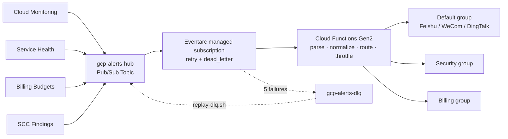

# GCP Alerts to Feishu/Lark, WeCom & DingTalk Bots

English | [简体中文](README.md)

Forwards four Google Cloud data sources — **Cloud Monitoring metric alerts, Personalized Service Health events, Cloud Billing budget overruns, and Security Command Center findings** — to an IM group bot as cards. Three platforms are supported: **Feishu/Lark, WeCom (企业微信) and DingTalk (钉钉)** — **pick one per deployment** (single platform: the default / security / billing routing groups all go to it).

10 minutes to deploy, under $0.50/month, no always-on resources.

> The function name `gcp-alerts-to-feishu`, the notification channel `Feishu Alert Hub`, the `feishu-*` secrets, the `<project>-gcp-feishu-tfstate` state bucket and similar names are **historical names, unrelated to the channel you pick** — kept for compatibility with existing deployments and reused as-is for WeCom / DingTalk.



---

## Prerequisites

- A GCP project where your identity has `roles/editor` **plus** `roles/resourcemanager.projectIamAdmin` (editor does not include `setIamPolicy`, and the script needs to grant roles to the function SA and service agents). Where editor is not an option, grant the [minimal role set in the full guide](docs/full-guide.md#所需-iam-权限).
- A group bot webhook URL for the platform you pick (**see [docs/bot-setup.md](docs/bot-setup.md) for step-by-step bot creation**, Chinese). Highlights:
  - **Feishu/Lark**: Group settings → Bots → Add bot → Custom bot. **Sign secret**: The secret Feishu gave you if signature verification is enabled, or the literal string `NONE` if disabled (cannot be blank).
  - **WeCom**: a group robot ("消息推送" / group bot) webhook — no signing.
  - **DingTalk**: a custom robot webhook plus its sign secret (`NONE` if signing is off).
- For local deploys, `gcloud` installed and authenticated. The Cloud Shell path below needs nothing installed locally.

---

## Quick start

The two paths are **functionally identical** (same topic, DLQ, function config, data sources, minimal IAM). They differ only in lifecycle management. **Do not run both** — they use the same resource names and will fight over ownership.

Without `--project`, the script lists your projects interactively. The choice takes effect for that run only and **does not rewrite your `gcloud` default config**.

### Choosing the notification channel (pick one)

Each deployment talks to **exactly one** IM platform. In interactive mode, the script shows a menu:

```
请选择通知渠道（每次部署只能选一个，default/security/billing 三类告警都发往该平台）：
  1) 飞书/Lark
  2) 企业微信
  3) 钉钉
输入编号 [1]:
```

Non-interactive (`--yes` / CI) runs read environment variables instead. `NOTIFY_CHANNEL` defaults to `feishu`:

```bash
# Feishu/Lark (FEISHU_SECRET=NONE when signature verification is off)
NOTIFY_CHANNEL=feishu FEISHU_WEBHOOK='https://open.feishu.cn/open-apis/bot/v2/hook/xxx' FEISHU_SECRET=NONE \
  ./deploy-gcloud.sh --project=my-proj --region=asia-east1 --yes

# WeCom (no signing — webhook only)
NOTIFY_CHANNEL=wecom WECOM_WEBHOOK='https://qyapi.weixin.qq.com/cgi-bin/webhook/send?key=xxx' \
  ./deploy-gcloud.sh --project=my-proj --region=asia-east1 --yes

# DingTalk (signing recommended: the SEC... secret; NONE when signing is off)
NOTIFY_CHANNEL=dingtalk DINGTALK_WEBHOOK='https://oapi.dingtalk.com/robot/send?access_token=xxx' DINGTALK_SECRET='SECxxx' \
  ./deploy-gcloud.sh --project=my-proj --region=asia-east1 --yes
```

`deploy-terraform.sh` reads the same variables and writes `notify_channel = "<channel>"` into `terraform.tfvars`.

### Path 1: gcloud quick start (~10 minutes)

```bash
./deploy-gcloud.sh --help                                  # see the available flags first
./deploy-gcloud.sh --region=asia-east1                     # pick the project interactively
./deploy-gcloud.sh --project=my-proj --region=asia-east1   # or name it directly
```

Zero local dependency version — click [](https://shell.cloud.google.com/cloudshell/editor?cloudshell_git_repo=https://github.com/Pandoraemon/gcp-mutil-notification-hub&show=terminal) (clones this repository; Cloud Shell ships with `gcloud`/`zip`/`envsubst` and you are already authenticated), then run:

```bash
cd ~/cloudshell_open/gcp-mutil-notification-hub && ./deploy-gcloud.sh
```

Or clone manually anywhere `gcloud` is authenticated:

```bash
git clone https://github.com/Pandoraemon/gcp-mutil-notification-hub.git && cd gcp-mutil-notification-hub && ./deploy-gcloud.sh
```

If your maintainer handed you a GCS artifact instead, use `gcloud storage cat gs://<bucket>/Multi-Notification-Hub-latest.tar.gz | tar -xz && cd Multi-Notification-Hub && ./deploy-gcloud.sh`.

### Path 2: Terraform production deploy (~15 minutes)

```bash
./deploy-terraform.sh --region=asia-east1
```

Additionally creates a versioned GCS state bucket and generates `terraform/backend.tf`. You get to review the plan before `terraform apply`.

---

## Changing configuration (configure.sh)

To change the channel / credentials / severity / rate / policies / data sources / switches of an existing deployment, use `scripts/configure.sh`: it reads the **live** state, shows an interactive main menu, previews "current → new", and on confirmation applies the change by calling the deploy script.

```bash
./scripts/configure.sh --project=my-project                  # interactive, shows the main menu for multi-selection
./scripts/configure.sh --project=my-project --section=filter # only one section (automation usage)
./scripts/configure.sh --project=my-project --dry-run        # show the diff only, no writes at all
SOURCE_MIN_SEVERITY="monitoring=HIGH;billing=OFF" ./scripts/configure.sh --project=my-project --yes   # non-interactive
```

See the [Full Guide (Chinese) · 修改配置](docs/full-guide.md#修改配置configuresh) for details.

---

## Day-2 operations

```bash
./scripts/configure.sh                      # change a deployed environment's config and restart
./scripts/emergency-disable.sh              # kill switch (drops messages, ~30s)
./scripts/emergency-disable.sh --pause      # pause (messages queue up, redelivered on resume)
./scripts/emergency-enable.sh               # resume
./scripts/replay-dlq.sh                     # interactive dead-letter replay
./scripts/teardown-gcloud.sh                # clean up resources created by the gcloud path
./scripts/teardown-terraform.sh             # destroy Terraform path resources and reclaim Secrets
```

The emergency switches are **not persistent configuration**: `emergency-*.sh` edit the underlying Cloud Run service's environment variables, and the next `deploy-gcloud.sh` / `terraform apply` resets them. For a durable stop / pause use `./scripts/configure.sh --section=switches`, or set `KILL_SWITCH=true ./deploy-*.sh` explicitly.

## Multi-Project Aggregation (Hub Mode)

You can route alerts and notifications from multiple source GCP projects through the single Hub project to your IM group. Each card will indicate its source project. Whether you add source projects interactively via menu option ⑧ in `configure.sh` or through the `source_projects` and `source_scope` variables in Terraform, the deploy scripts will automatically provision the required APIs, log sinks, and IAM permissions on the source projects or folder/organization scopes. For details, see [Multi-Project Hub Mode Guide](docs/multi-project-hub.md) (in Chinese).

---

## Documentation

*Note: All detailed documentation is currently in Chinese.*

- [**Full Guide**](docs/full-guide.md) —— Channel selection, minimal IAM roles, configuration, operations, FAQ, known limitations.
- [**Bot Setup**](docs/bot-setup.md) —— Step-by-step bot creation for Feishu / WeCom / DingTalk and webhook verification.
- [**Troubleshooting**](docs/troubleshooting.md) —— Common issues, error codes, and diagnostic commands.
- [Deployment Comparison](docs/deployment-comparison.md) —— gcloud vs Terraform, migration steps.
- [Multi-Project Hub](docs/multi-project-hub.md) —— Hub mode configuration.
- [Architecture](docs/architecture.md) —— Data flow, three-tier reliability, self-monitoring, configuration source of truth, known limitations (Chinese).
- [Cost Estimation](docs/cost-estimation.md) —— Cost breakdown.

**Deployed successfully but no cards?** The two most common causes are a mismatched sign secret (look for `code=19021` in the logs on Feishu, `errcode=310000` on DingTalk) and a data source's service agent missing the topic publisher role (no error at all — messages simply never arrive). Follow the first three commands in [docs/troubleshooting.md](docs/troubleshooting.md).
