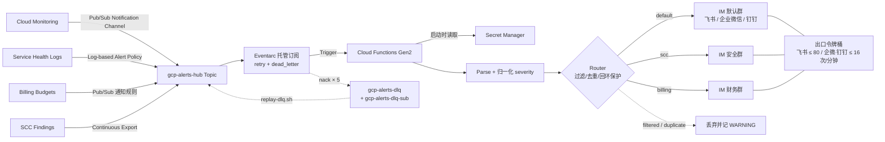
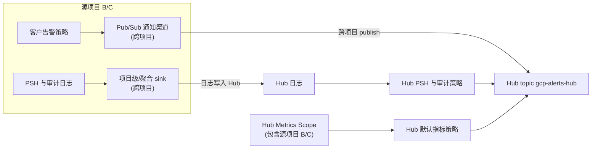

# 架构说明

## 一句话概括

四个 GCP 告警源 → 一个 Pub/Sub 主题 → 一个 Cloud Functions Gen2 函数 → IM 渠道（飞书/Lark、企业微信、钉钉，每次部署三选一）群机器人卡片。

所有复杂度都集中在一件事上：**让"部署成功但告警发不出来"这类静默失效变得不可能**。

> 函数名 `gcp-alerts-to-feishu`、通知渠道 `Feishu Alert Hub` 等名称中的 feishu 是历史命名，与所选渠道无关。

---

## 端到端数据流

### 三个容易搞反的地方

1. **死信策略挂在 Eventarc 托管订阅上，不是挂在函数上。**
   函数必须以 `--retry`（Terraform 中 `retry_policy = "RETRY_POLICY_RETRY"`）部署。
   Gen2 事件函数默认不重试 —— 抛异常等于 ack 丢弃，死信策略永远不会触发。

2. **重放路径是 DLQ → 主 topic，不是 DLQ → 函数。**
   走完整链路才能复用解析、路由、限流全部逻辑，并保留原始消息属性。

3. **速率控制在出口（令牌桶），不依赖 `max_instances`。**
   实例数不是速率控制手段；总出速率 = 单实例速率 × 实例数，二者相乘必须 ≤ 渠道上限
   （飞书 80 / 企业微信 16 / 钉钉 16，= 平台单机器人限流 100 / 20 / 20 × 80%）。

### 多项目汇聚（Hub 模式）数据流

- **Metrics 与客户策略路由**：源项目通过跨项目的 Pub/Sub 通知渠道将告警发往 Hub topic。通过 Metrics Scope 关联，Hub 上的默认指标策略可直接涵盖并监控所有已接入源项目的资源。
- **日志告警路由设计（Routed Audit Logs）**：日志型告警策略只评估 `_Default` 桶中的日志。从源项目路由进 Hub 的审计日志（`cloudaudit.googleapis.com/activity` / `system_event`）会被 Hub 的 `_Default` sink 按 `LOG_ID` 排除，因而不会进入 `_Default` 桶，Hub 上的高危 IAM / SA 密钥 / 宿主机维护策略也就不会触发。因此部署脚本会在 Hub 创建回灌 sink `gcp-alerts-hub-routed-audit`（过滤条件：上述两个 `LOG_ID` 且 `NOT logName:"projects/<Hub>/"`），把非本项目的审计日志写回 `_Default` 桶（gcloud：`ensure_hub_routed_audit_sink`；TF：`hub_routed_audit`）。路由后的日志保留源项目的 `logName`，所以 Hub 侧所有日志告警策略都必须用 `LOG_ID(...)` 匹配，不能硬编码 `logName="projects/<id>/..."`。实测从 IAM 变更到卡片送达约 4 分钟。

---

## 为什么钉钉 130101 不在函数内重试

钉钉单机器人 20 条/分钟，超限返回 `errcode=130101` 并**封禁约 10 分钟**。基类默认对瞬时错误做函数内退避重试
（间隔约 1 / 2 秒），这在 10 分钟封禁期内必然再失败：只会白耗令牌（每次 HTTP 尝试各取 1 个）、拉长函数执行时间、
挤占同实例后续消息的出口额度。所以 `DingtalkSender.should_retry_in_process()` 对 130101 返回 `False`：
异常照常作为 `TransientError` 抛出（记 WARNING `Transient failure not retried in-process, deferring to Pub/Sub redelivery`），
`main.py` nack，交给 Pub/Sub 订阅的指数退避重投。重投退避为 `min-retry-delay=10s` 起步翻倍，默认 5 次投递在约 2–3 分钟内耗尽 ——
远短于 10 分钟封禁，所以**风暴中被 130101 拒绝的消息几乎必然进 DLQ**（这是确定结局而非偶发），封禁解除后用 `replay-dlq.sh` 重放。
封禁期内每次重投仍会请求一次钉钉；平台是否因此延长封禁未经官方文档确认。
**不做函数内重试 ≠ 放弃**。企业微信 45009 约 1 分钟解除，仍走默认的函数内重试。

---

## 三层可靠性设计

### 第一层：让失败可见

- 结构化 JSON 日志，每行带 `message_id` 与 `logging.googleapis.com/trace`，
  同一次调用的所有日志行在 Cloud Logging 中可一键关联。
- IM 平台 HTTP 200 **不等于**成功：必须检查响应体业务码（飞书 `code`、企业微信 / 钉钉 `errcode`）。签名配错时飞书返回
  `200 + {"code": 19021}`、钉钉返回 `200 + {"errcode": 310000}`，若只看状态码，所有卡片都会被静默丢弃且日志显示"成功"。
  `transient_send_failure` / `permanent_send_failure` / `Send failed, retrying` 三条日志都带独立字段
  `channel`、`http_status` 与 `platform_code`（可为 null），Logs Explorer 可直接 `jsonPayload.platform_code=45009` 过滤；
  飞书日志另保留 `feishu_code`（同值），存量过滤器 `jsonPayload.feishu_code=19021` 继续可用。
  200 + 合法 JSON 但不是对象的响应体与「200 非 JSON」同类，按 TransientError 处理；未列出的错误码也按瞬时处理
  （最坏是多重试几次后进 DLQ 可重放，而不是静默 ack）。三渠道错误码分类见 [troubleshooting.md](troubleshooting.md#27-三渠道错误码速查)。
- 未知 severity fail-open 到 HIGH，并记 WARNING 带上 `raw_severity` ——
  映射表的缺口能被发现，而不是让告警悄悄消失。
- 启动时记一条 `Config loaded` INFO 快照（`channel` / `min_severity` / `kill_switch` / `pause_mode` / `self_project_id` 等），
  用来核对线上实际生效的配置；`repr(Target)` 不含 webhook / secret。
- webhook 前缀按渠道白名单在启动期校验（飞书 `open.feishu.cn` / `open.larksuite.com`、企业微信 `qyapi.weixin.qq.com/cgi-bin/webhook/send?key=`、
  钉钉 `oapi.dingtalk.com/robot/send?access_token=`），配置错误在冷启动时暴露，而不是在 DLQ 里。

### 第二层：让失败可恢复

- Eventarc 订阅重试 5 次后转入 DLQ；DLQ 有独立订阅（保留 7 天，永不过期）。
  进 DLQ 的只有瞬时失败重试耗尽与 `PAUSE_MODE` 两种来源（见上节）。
- `scripts/replay-dlq.sh` 先预览并立即归还租约，人工确认后重新拉取再投回主 topic，
  并递增 `replay_count` 属性；函数在 `replay_count > 2` 时直接丢弃，阻断"DLQ → 重放 → 再入 DLQ"的死循环。
- 冷启动时 Secret Manager 故障 → 实例启动失败 → 消息堆积在订阅中（7 天）→ 恢复后自动重投。
  **不做降级**：保留明文环境变量副本会违背"无硬编码密钥"。

### 第三层：让失败不放大

| 放大路径 | 拦截手段 |
|---------|---------|
| 函数自身故障产生告警 → 触发自己 → 风暴 | `Router.is_self_referential`（比对 `source_project` + 资源名） |
| Pub/Sub 至少一次语义导致重复投递 | 进程内 TTL 去重（600s / 1024 条 LRU） |
| 预算每天多次推送状态消息，被当成告警刷屏 | 无阈值 → `SkipAlert`；dedup_key 带 `costIntervalStart`，同周期同阈值只发一次 |
| 告警风暴打爆 IM 平台限流 | 出口令牌桶，`MAX_SENDS_PER_MINUTE × max_instances ≤ 80 / 16 / 16`（飞书 / 企业微信 / 钉钉）；**每次 HTTP 尝试（含 3 次内部重试）各取 1 个令牌**，所以该值是真实出口请求上限；钉钉 130101 跳过函数内重试（见上文） |
| 一条畸形消息占满重试配额 | 永久性失败直接 ack，不进重试循环 |
| 告警文本把卡片当成攻击面（Markdown 链接钓鱼、`<at id=all>`、裸 URL） | 来自告警数据的字段只渲染纯文本：飞书 `plain_text`；企业微信只进 `template_card` 纯文本字段；钉钉 ` ] < > *` 全角替换 + 换行折叠；企微 / 钉钉另做裸 URL 去活（`https[:]//`）。`console_url` 只接受 `https://console.cloud.google.com/` / `https://cloud.google.com/` 前缀，否则回落默认控制台链接并记 WARNING `reason=console_url_rejected`；企微 / 钉钉按钮再经 `sanitize.button_url()` 收口（超 1024 字节回落 Cloud Console 首页）。|
| 事故中人工止血需要秒级生效 | `KILL_SWITCH` / `PAUSE_MODE` 软开关，不触碰基础设施（注意会被下一次部署复位，线上为 true 时部署脚本打印 WARNING；持久急停用 `configure.sh --section=switches`） |

---

## 监控的监控（自监控）

本函数的失效终点是「ack + ERROR 日志」—— webhook token 失效、机器人被移出群、签名长期配错，
每条消息都会被正确地永久失败并 ack，**没有任何东西会主动告诉人**。这正是本项目最反对的静默失效，
所以 `main.py` 在 `permanent_send_failure` 处明确依赖下面这两条告警策略兜底。

| 策略 displayName | 类型 | 条件 | 节流 / 自动关闭 |
|-----------------|------|------|----------------|
| `GCP Alerts Hub - Permanent Send Failure` | 日志型 | `resource.type="cloud_run_revision" AND resource.labels.service_name="<函数名>" AND jsonPayload.reason="permanent_send_failure"` | 每 1h 最多通知一次 / 24h 自动关闭 |
| `GCP Alerts Hub - DLQ Backlog` | 指标型 | `pubsub.googleapis.com/subscription/num_undelivered_messages` on `gcp-alerts-dlq-sub` `> 0` 持续 600s | 默认 |

**通知渠道只用邮件**（`GCP Alerts Hub Ops Email`），刻意不挂 IM 渠道（飞书 / 企业微信 / 钉钉）：
在这两种场景里 IM 链路正是坏掉的那一环，再经它通知等于没通知。多渠道改造不改变这一点 —— 无论选哪个平台，自监控都只走邮件。

- **开关**：gcloud 路径的 `OPS_EMAIL` 环境变量 / 交互提示；Terraform 路径的 `ops_email` 变量
  （`terraform/self_monitoring.tf`，空则全部 `count = 0`）。两条路径建的资源相同。
- **未配置时的后果**：两条路径都把它登记为「已跳过」，退出码为 2（部署不完整），不是静默跳过。
  此时 webhook 失效将只体现在 ERROR 日志里，直到有人去看日志或群里长期安静才会被发现。
- **第一层仍然有效**：即使没配邮箱，`permanent_send_failure` 日志照常写入，
  可以用任何已有的日志告警体系（或 `troubleshooting.md` 的第一条命令）接管。

---

## 两条部署路径的关系

功能完全对等，差别只在生命周期管理，详见 [deployment-comparison.md](deployment-comparison.md)。

一处刻意的不对称：**Secret 的值在两条路径下都由 shell 脚本（gcloud）写入**。
若交给 Terraform 管理，密文会明文落进 tfstate。Terraform 只用 `data` 源只读引用，
并负责授予 accessor IAM —— 因为 IAM 需要引用 Terraform 创建的 Service Account。
多渠道下两条路径都只创建 / 引用 / 授权**所选渠道**的 Secret：Terraform 侧所有随渠道变化的值
（`local.channel_secrets`、`local.max_sends_per_minute`、`local.rate_cap`、`local.channel_label`）集中在 `terraform/channels.tf` 查表，
accessor 改为 `google_secret_manager_secret_iam_member.secret_accessor[<ENV 名>]`（`for_each`），
`secrets.tf` 的 `moved` 块让存量飞书部署升级时 plan 零变更。

Terraform 路径中还有一处 `local-exec`：给 Eventarc **托管**订阅挂死信策略。
托管订阅由 Eventarc 自行创建（名字带 hash），google provider 无法声明式管理它，
因此调用与 gcloud 路径完全相同的命令来挂载。理由与取舍写在 `terraform/pubsub.tf` 的注释里。

### 配置的真相源与 configure.sh

**配置的真相源是线上的函数与资源**（函数 env / Secret 挂载、告警策略、预算、SCC 导出），不是本地文件：

- gcloud 路径根本没有本地配置文件；Terraform 路径的 `terraform.tfvars` 由 `deploy-terraform.sh` **每次重新生成**，
  不随仓库提交、换台机器就不存在，只作为现状读不到时的兜底。
- 因此两条部署脚本在函数已存在时先读线上现状，对未显式提供的变量**沿用线上值**（「重跑部署不回退配置」），
  并打印「沿用线上配置：…」；只有 `KILL_SWITCH` / `PAUSE_MODE` 仍按「重跑部署 = 解除急停」复位为 false。
  现状读不到时 gcloud 路径保持不动（只 upsert 的路径「不建」即安全），Terraform 路径则要求显式提供
  （tfvars 写 false = apply 删除资源，不能猜）。

`scripts/configure.sh` 是这套语义之上的交互层：读线上现状 → 分区引导 → 差异预览 → 以环境变量调用
`deploy-gcloud.sh --yes` / `deploy-terraform.sh --yes`（按 topic 的 `managed-by=terraform` 标签选择）→ 校验重启。
它**复用部署脚本，而不直接改 Cloud Run 服务**，原因：

- **改动必须能经受下一次部署。** `emergency-*.sh` 那种直接改底层 Run 服务 env 的做法，会被下一次 `deploy-gcloud.sh`
  （`--set-env-vars` 整体替换）或 `terraform apply`（视为漂移）复位；Terraform 模式下绕过 state 的修改更是必然被回滚。
  走部署脚本，gcloud 模式下线上即真相，Terraform 模式下 tfvars 与 state 同步更新。
- **只有一套校验与副作用逻辑。** 渠道速率上限、Secret 写入 / `KEEP_EXISTING_SECRETS` 校验、IAM、自检都在部署脚本里，
  configure 不复制这些逻辑，两条路径的对等性也不会因此分叉。
- **重启是确定的。** configure 每次应用写入新的 `CONFIG_REVISION`（Terraform `config_revision`），env 变化保证拉新 revision，
  让 `:latest` 的 Secret 被重新解析；然后核对函数上的 `CONFIG_REVISION` 与最新 revision 创建时间。

唯一由 configure 自己执行的写操作是 gcloud 模式下「开 → 关」的资源删除：gcloud 部署脚本只 upsert、不删除，
所以由 configure 在部署脚本之后按精确 displayName / 资源名删除（带 `managed-by=terraform` 标签的跳过）。
Terraform 模式的删除由 `apply` 完成。`emergency-*.sh` 仍保留为事故中的秒级止血手段，不是配置手段。

---

## 数据源接入矩阵

| 数据源 | 默认状态 | 权限要求（缺失时的行为） | gcloud | Terraform |
|--------|---------|------------------------|--------|-----------|
| Cloud Monitoring | ✅ 开启 | `roles/monitoring.editor`（部署失败） | ✅ | ✅ |
| Service Health | ✅ 开启 | `roles/monitoring.editor` + `roles/logging.viewer`（部署失败） | ✅ YAML 模板 | ✅ |
| Billing Budgets | ❌ 关闭 | `roles/billing.costsManager`（结算账号级，**探测后优雅跳过**） | ✅ | ✅ |
| SCC | ❌ 关闭 | `roles/securitycenter.notificationConfigEditor`（org 级，**探测后优雅跳过**） | ✅ | ✅ |

权限探测一律用 `list` 而非 `describe`：`describe` 探测的是"资源是否已存在"，
首次部署必然失败并被误判为"无权限"，导致可选数据源永远配不上。

每个数据源用**不同的服务代理**向 topic 投递，漏授权的表现都是"静默无告警"：

| 数据源 | 服务代理 |
|--------|---------|
| Cloud Monitoring | `service-{项目编号}@gcp-sa-monitoring-notification.iam.gserviceaccount.com` |
| Pub/Sub（死信转发） | `service-{项目编号}@gcp-sa-pubsub.iam.gserviceaccount.com` |
| SCC | `service-org-{组织 ID}@gcp-sa-scc-notification.iam.gserviceaccount.com` |
| Billing | `billing-budgets-pubsub@system.gserviceaccount.com`（固定账号） |

服务代理是**懒创建**的：对尚不存在的 SA 做 `add-iam-policy-binding` 会失败，
或写入一条永不生效的绑定。因此 `lib/common.sh::ensure_service_agents` 先用
`gcloud beta services identity create` 显式创建，再做授权。

---

## 已知限制（v1）

| 限制 | 影响 | 计划 |
|-----|------|------|
| 去重是进程内的 | `max_instances=2` 时最坏重复 1 次 | v2 用 Firestore 做跨实例强一致去重 |
| 令牌桶是进程内的 | 总速率靠 `速率 × 实例数 ≤ 80 / 16 / 16` 静态保证 | v2 用 Redis/Firestore 做分布式限流 |
| 卡片是一次性的 | 同一 incident 的多次更新会发多张卡片 | v2 用飞书自建应用更新同一张卡片 |
| 多群路由需手工加 secret | 部署脚本只创建默认群的 secret | 见 [troubleshooting.md](troubleshooting.md#5-多群路由) |
| 单平台部署 | 一次部署只能发往一个 IM 平台 | 有意的取舍；需要多平台时分项目部署 |
| 输入侧不鉴别来源 | 对 topic `gcp-alerts-hub` 有 `roles/pubsub.publisher` 的任何主体都能发布一条结构合法的消息，被当作告警转发到群里（`validate_alert` 只校验结构与按钮 URL 白名单，不校验发送者） | 把该 topic 的 publisher 权限只留给各数据源服务代理与部署者，定期审计 `gcloud pubsub topics get-iam-policy gcp-alerts-hub` |
| 默认告警包 / PSH 策略由部署拥有 | 重跑部署或 `apply` 会把这些策略复位为模板定义，覆盖在控制台做的阈值调整 | 需要自定义时关闭对应开关（`ENABLE_DEFAULT_ALERTS=N` / `enable_default_alerts=false`）后自行维护副本 |
