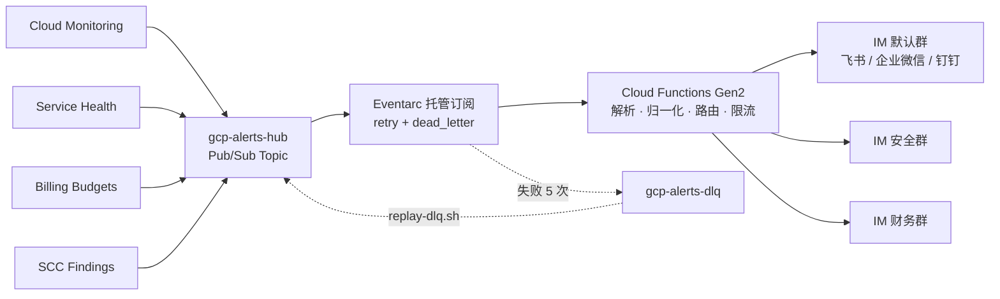

# GCP 全方位告警转发 IM 机器人（飞书 / 企业微信 / 钉钉）—— 完整指南

> 本文是项目的完整说明：渠道选择、权限模型、降级行为、配置项、项目结构、FAQ、已知限制。
> 只想尽快部署，看 [README](../README.md)。

把 Google Cloud 的四个数据源 —— **Cloud Monitoring 指标告警、Personalized Service Health
服务健康事件、Cloud Billing 预算超支、Security Command Center 安全发现** ——
统一转成 IM 群机器人卡片。支持 **飞书/Lark、企业微信、钉钉**，**每次部署三选一**
（单平台：default / security / billing 三个路由组都发往同一平台），见[选择通知渠道](#选择通知渠道三选一)。

10 分钟部署，月成本 < $0.50，无常驻资源。



---

## 为什么不是"一个 webhook 转发脚本"

因为告警系统真正的失效模式不是崩溃，而是**沉默**。
部署显示成功、日志显示正常、群里就是没有卡片 —— 而你直到事故发生才发现。

这个项目里绝大部分代码都在处理这一类问题：

| 静默失效 | 处理方式 |
|---------|---------|
| IM 平台返回 HTTP 200 但业务码非 0（飞书 `code` / 企业微信、钉钉 `errcode`；签名配错时全部卡片被丢弃） | 校验响应体业务码，按渠道区分永久/瞬时失败 |
| 未设 severity 的 Monitoring 策略在默认配置下被全部过滤 | 未知严重性 **fail-open 到 HIGH**，并记 WARNING |
| 服务代理未创建就授权，写入一条永不生效的 IAM 绑定 | 先 `services identity create` 再绑定 |
| Gen2 事件函数默认不重试，抛异常等于 ack 丢弃 | 强制 `--retry`，死信策略才可能触发 |
| DLQ 主题没有订阅，死信被直接丢弃 | 显式创建 DLQ 订阅（永不过期） |
| 告警文本含引号/换行导致卡片 JSON 非法 | 飞书模板全部插值走 `\| tojson`，9 类敌意输入 × 5 种模板的属性测试；企业微信 / 钉钉用 Python 直接构造 dict，由 `requests` 序列化 |
| 重跑部署脚本时 Secret 静默沿用旧值 | `upsert_secret` 追加新版本 |
| 函数自身故障产生的告警再次触发自己 | 回环保护 `is_self_referential` |
| 紧急止血时删掉了并不存在的订阅 | `KILL_SWITCH` 软开关，不触碰基础设施 |
| 预算的周期性状态推送（无阈值）被当成 HIGH 告警刷屏 | 识别为「合法但无需投递」，`SkipAlert` → INFO 日志 + ack |
| 告警文本里的 Markdown 链接 / `<at id=all>` 在卡片中生效 | 来自告警数据的字段一律纯文本（飞书 `plain_text`、企业微信纯文本字段、钉钉全角替换 + URL 去活）；按钮 URL 只接受 Google Cloud 控制台前缀 |
| IM webhook 失效后 ack + ERROR 日志，无人知晓 | 「监控的监控」：永久发送失败 / DLQ 积压两条策略走**邮件**渠道（`OPS_EMAIL`） |

---

## 快速开始

### 前置条件

- 一个 GCP 项目，当前身份具备 `roles/editor` 或[下面列出的最小角色集](#所需-iam-权限)
- 所选平台的一个群机器人 Webhook URL：飞书/Lark（群设置 → 群机器人 → 添加机器人 → 自定义机器人）、
  企业微信群机器人或钉钉自定义机器人，创建要点见[选择通知渠道](#选择通知渠道三选一)
- 本地部署还需已安装并登录 `gcloud`；走下面的 Cloud Shell 路径则无需任何本地安装

### 所需 IAM 权限

`roles/editor` 能跑通核心部署，但**不含 `resourcemanager.projects.setIamPolicy`** ——
脚本要给函数 SA 和各服务代理授权，所以 editor 也必须额外配 `projectIamAdmin`。
不能发 editor 的环境，按下面三张表授予；它们分属**三个不同的授权层级**，
要用三条不同的命令，混在一层是这类配置最常见的失败方式。

**① 项目级（核心部署必需）**

| 角色 | 用于哪一步 |
|-----|-----------|
| `roles/serviceusage.serviceUsageAdmin` | 启用 11 个 API、创建服务代理（P4SA） |
| `roles/resourcemanager.projectIamAdmin` | 给函数 SA 授 secretAccessor（secret 级）；`run_invoker_scope = "project"` 时还用于项目级 `run.invoker` |
| `roles/pubsub.admin` | 建 topic、DLQ、订阅、死信策略，以及给各服务代理授 publisher |
| `roles/secretmanager.admin` | 创建 webhook / 签名密钥的 Secret 并追加版本 |
| `roles/storage.admin` | 源码 bucket（Terraform 路径还有 state bucket） |
| `roles/cloudfunctions.developer` | 部署 Gen2 函数 |
| `roles/iam.serviceAccountAdmin` | 创建自定义运行时 SA `gcp-alerts-fn` |
| `roles/iam.serviceAccountUser` | **把运行时 SA 附加给函数**（见下方注意事项） |
| `roles/monitoring.notificationChannelEditor` | 创建 / 复用 Notification Channel；`OPS_EMAIL` 非空时还要创建邮件渠道 |
| `roles/monitoring.alertPolicyEditor` | 创建 / 更新 Service Health 告警策略、推荐默认告警包；`OPS_EMAIL` 非空时还有两条自监控策略 |
| `roles/logging.configWriter` | 同上 —— Service Health 与「永久发送失败」自监控是**日志型**告警策略，另需 `logging.notificationRules.create`（见下方注意事项） |
| `roles/logging.viewer` | 部署后自检读取函数日志 |
| `roles/browser` | 列出可选项目、读取项目编号与所属组织 |

**部署前权限预检**：两条路径都会在启用 API 之前调用
`cloudresourcemanager projects:testIamPermissions`（只读，不建任何资源）探测下面 8 项权限，
缺失时列出清单并拼出一条可直接粘贴的 `add-iam-policy-binding` 补救命令
（`--member=` 默认按 `gcloud config get-value account` 解析为 `user:` / `serviceAccount:`，
WIF `principal://` 身份请用 `DEPLOYER_MEMBER` 环境变量显式指定）。
交互模式会询问是否继续；`--yes` / 非 TTY 只打印不阻塞；curl 失败或 HTTP 非 2xx（API 未启用、CBA、代理）只 WARNING 不阻塞。

| 预检的权限 | 对应角色 |
|-----------|---------|
| `resourcemanager.projects.setIamPolicy` | `roles/resourcemanager.projectIamAdmin` |
| `serviceusage.services.enable` | `roles/serviceusage.serviceUsageAdmin` |
| `iam.serviceAccounts.create` | `roles/iam.serviceAccountAdmin` |
| `secretmanager.secrets.create` | `roles/secretmanager.admin` |
| `pubsub.topics.create` | `roles/pubsub.admin` |
| `cloudfunctions.functions.create` | `roles/cloudfunctions.developer` |
| `monitoring.alertPolicies.create` | `roles/monitoring.alertPolicyEditor` |
| `monitoring.notificationChannels.create` | `roles/monitoring.notificationChannelEditor` |

探测结果**偏保守**：组成员、条件绑定、自定义角色可能不计入。预检通过 ≠ 一定成功，预检失败 ≠ 一定失败 ——
它只是把「跑到第 13 步才发现缺权限」提前到第一步。

除部署者本身外，还有**两个服务账号**需要项目级角色。它们容易被漏掉，因为报错都不指向 IAM：

| 被授权者 | 角色 | 不给会怎样 |
|---------|-----|-----------|
| `<项目号>-compute@developer.gserviceaccount.com`（Cloud Build 用） | `roles/cloudbuild.builds.builder` | 函数**构建失败**，报 "missing permission on the build service account"。2024 年起 Google 不再给新项目的默认 compute SA 自动授 Editor，新项目必踩 |
| `gcp-alerts-fn@<项目>.iam.gserviceaccount.com`（触发器身份） | `roles/run.invoker` | Eventarc 调不动函数：**投递被 403 拒绝、函数从未执行、日志里只有 WARNING**，部署与控制台看起来一切正常 |

**② 组织级（仅在启用 SCC 时需要）**

| 角色 | 授予位置 |
|-----|---------|
| `roles/securitycenter.notificationConfigEditor` | **组织**，非项目 |

**③ 结算账号级（仅在启用 Billing 预算时需要）**

| 角色 | 授予位置 |
|-----|---------|
| `roles/billing.costsManager` | **结算账号**，非项目。含 `billing.budgets.*` 全部权限；`roles/billing.admin` 是其超集 |
| `roles/billing.viewer` | 项目级，用于读出项目关联的结算账号 |

一键授予（把三个 `XXX` 换成你的值）：

```bash
PROJECT_ID=your-project
MEMBER='user:someone@example.com'      # 或 serviceAccount:ci@....iam.gserviceaccount.com

for role in serviceusage.serviceUsageAdmin resourcemanager.projectIamAdmin \
            pubsub.admin secretmanager.admin storage.admin \
            cloudfunctions.developer iam.serviceAccountAdmin iam.serviceAccountUser \
            monitoring.notificationChannelEditor monitoring.alertPolicyEditor \
            logging.configWriter logging.viewer browser; do
  gcloud projects add-iam-policy-binding "${PROJECT_ID}" \
    --member="${MEMBER}" --role="roles/${role}" --condition=None >/dev/null
done

# 两个服务账号（缺了都不报 IAM 错，只是悄悄不工作）
PROJECT_NUMBER=$(gcloud projects describe "${PROJECT_ID}" --format='value(projectNumber)')
gcloud projects add-iam-policy-binding "${PROJECT_ID}" \
  --member="serviceAccount:${PROJECT_NUMBER}-compute@developer.gserviceaccount.com" \
  --role='roles/cloudbuild.builds.builder' --condition=None >/dev/null
gcloud projects add-iam-policy-binding "${PROJECT_ID}" \
  --member="serviceAccount:gcp-alerts-fn@${PROJECT_ID}.iam.gserviceaccount.com" \
  --role='roles/run.invoker' --condition=None >/dev/null   # 须在函数首次部署后执行

# 仅启用 SCC 时（需要组织管理员执行）
gcloud organizations add-iam-policy-binding YOUR_ORG_ID \
  --member="${MEMBER}" --role='roles/securitycenter.notificationConfigEditor'

# 仅启用 Billing 预算时（需要结算账号管理员执行）
gcloud billing accounts add-iam-policy-binding YOUR_BILLING_ACCOUNT_ID \
  --member="${MEMBER}" --role='roles/billing.costsManager'
```

三个容易踩的点：

- **`roles/iam.serviceAccountUser` 是最容易漏的一个。** 缺它时，前面所有资源都会创建成功，
  只在 `gcloud functions deploy` 那一步失败，报错指向 `actAs` 权限而不提运行时 SA ——
  看起来像"函数部署炸了"，实际是授权问题。
- **Gen2 的部署动作不需要单独授 `run.*` / `eventarc.*` / `artifactregistry.*` / `cloudbuild.*`**
  —— 这些已包含在 `roles/cloudfunctions.developer` 内。但**给 Run 服务改 IAM 是例外**：
  `run.services.setIamPolicy` 不在该角色里，所以上表那条 `run.invoker` 要么授在
  **项目级**（用已有的 `projectIamAdmin` 即可），要么额外给部署者 `roles/run.admin`
  才能授在服务级。gcloud 路径的脚本优先检查项目级绑定，避免为此扩权；
  **Terraform 路径默认服务级**（`run_invoker_scope = "service"`，最小权限），
  部署者缺 `run.admin` 时请在 `terraform.tfvars` 设 `run_invoker_scope = "project"`。
- **Service Health 策略是日志型的，`monitoring.alertPolicyEditor` 不够。**
  实际被拒的权限是 `logging.notificationRules.create`，来自 `roles/logging.configWriter`。
- **缺权限不会中断部署，但也不会假装成功。** 见下节。

以上是**部署者身份**的权限。**函数运行时**用的是另一个身份（自定义 SA `gcp-alerts-fn`），
由脚本自动创建，只有 `roles/secretmanager.secretAccessor`（逐 Secret 绑定）与底层 Run 服务上的
`roles/run.invoker`（作为 Eventarc 触发器身份；gcloud 路径通过 `--trigger-service-account` 指定，
与 Terraform 一致）—— 函数只写 stdout，由平台采集，**不需要也不再授 `roles/logging.logWriter`**
（teardown 仍会回收旧环境里的该绑定）。不要把上面这些部署权限授给它。

自定义 SA 创建失败时脚本会回落到默认 compute SA：能跑，但权限面大得多，
且 secretAccessor 与触发器身份也都落在默认 compute SA 上 —— 这应被视为降级而非常态。

### 权限不够时会怎样

**不中断主流程，但也不会假装成功。** 步骤分两级：

- **必需**（topic 与订阅、Secret 写入、源码上传、函数部署）—— 缺权限立即中止。
  缺了它们，继续下去只会产出一个不工作的空壳。
- **可降级**（服务代理授权、自定义 SA 与 IAM 绑定、死信策略、Notification Channel、
  Service Health 策略、推荐默认告警包、自监控（`OPS_EMAIL`）、SCC、Billing、自检读日志）—— 打印影响与补权命令后**跳过，继续往下跑**。

结尾会汇总一份清单：

```
⚠️  本次部署【不完整】：2 个步骤因权限不足被跳过

  1. 给 Monitoring 服务代理授 gcp-alerts-hub 的 publisher
     影响：Cloud Monitoring 指标告警将【静默】进不来 —— 部署看起来成功、
           日志也没有错误，群里就是收不到卡片
     补救：gcloud pubsub topics add-iam-policy-binding gcp-alerts-hub \
             --member=serviceAccount:service-...@gcp-sa-monitoring-notification... \
             --role=roles/pubsub.publisher --project=...
  2. ...

  补齐权限后重跑本脚本即可 —— 全流程幂等，已建成的资源不会重复创建。
```

**退出码区分三态**：`0` 完全成功 / `2` 不完整（核心链路已建立，有步骤被跳过）/
`1` 失败或自检未通过。CI 里请按这三态判断，不要只看"是否非 0"。

只要有任何跳过项，脚本就**不会**打印"部署完成"。这是有意的：跳过一步服务代理授权，
表现恰恰是"资源都在、日志无错、控制台全绿，告警就是进不来" —— 也就是本项目开篇那张
静默失效表里的一行。让不完整的部署看起来成功，等于亲手制造它。

有一个级联行为值得知道：Notification Channel 创建失败时，脚本**不会**继续创建 Service
Health 告警策略。一条没有通知渠道的策略在控制台里显示为正常，却永远不发通知 ——
比不创建更糟。

### 路径 0：Cloud Shell（零本地依赖）

[](https://shell.cloud.google.com/cloudshell/editor?cloudshell_git_repo=https://github.com/Pandoraemon/gcp-mutil-notification-hub&show=terminal)

点开按钮进入 Cloud Shell（自动克隆公开仓库 `https://github.com/Pandoraemon/gcp-mutil-notification-hub`，自带 `gcloud`/`zip`/`envsubst` 且已登录），执行：

```bash
cd ~/cloudshell_open/gcp-mutil-notification-hub && ./deploy-gcloud.sh
```

不用按钮也可以手动克隆：`git clone https://github.com/Pandoraemon/gcp-mutil-notification-hub.git && cd gcp-mutil-notification-hub`。
若维护者提供的是私有 GCS 制品包（定制版），改用：

```bash
gcloud storage cat gs://<bucket>/Multi-Notification-Hub-latest.tar.gz | tar -xz \
  && cd Multi-Notification-Hub && ./deploy-gcloud.sh
```

脚本随后会**列出你有权限的项目让你选**，不需要事先 `gcloud config set project`。

### 路径 1：gcloud 快速体验（约 10 分钟）

```bash
./deploy-gcloud.sh --help                                  # 先看看有哪些参数
./deploy-gcloud.sh --region=asia-east1                     # 交互式选择项目
./deploy-gcloud.sh --project=my-proj --region=asia-east1   # 或直接指定
```

脚本会先让你选择目标项目，再依次询问**通知渠道**（飞书/Lark、企业微信、钉钉）、该渠道的 webhook 与签名密钥、是否启用 PSH / 推荐默认告警包 / SCC / Billing，
以及**运维通知邮箱**（提示文案「运维通知邮箱（IM 链路自身故障时的兜底收件人，留空跳过）」，
对应环境变量 `OPS_EMAIL`；留空会登记为「已跳过」并使退出码为 2，不是静默跳过）。
随后按以下顺序执行（与 `deploy-gcloud.sh` 中的步骤编号一致）：

| 步骤 | 内容 |
|-----|------|
| 1 | 交互式输入（先问，避免启用一堆 API 后才发现用户想取消）；含渠道选择与 `速率 × MAX_INSTANCES` 上限校验（超限直接退出 1） |
| 1.5 | **部署者权限预检**（只读，见上节） |
| 2 | 启用 API + 创建服务代理 |
| 2.5 | 构建身份：给默认 compute SA 补 `cloudbuild.builds.builder` |
| 3 | Secret Manager（只写所选渠道的 Secret；幂等：已存在则追加新版本） |
| 4 | 自定义运行时 SA（失败回落默认 compute SA）；对所选渠道每个 Secret 逐个授 `secretAccessor` |
| 5 | Pub/Sub：主 topic + DLQ topic + DLQ 订阅 |
| 6 | 各服务代理的 publisher 授权 |
| 7 | 源码打包上传 |
| 8 | 部署 Cloud Functions Gen2（`--retry` + `--trigger-service-account=<函数 SA>`；`--set-env-vars` 含 `NOTIFY_CHANNEL`，`--set-secrets` 只挂本渠道映射，`--max-instances=${MAX_INSTANCES}`） |
| 8.5 | 确保触发器身份有 `run.invoker` |
| 9 | 给 Eventarc 生成的订阅挂死信策略 |
| 10 | Monitoring Notification Channel「Feishu Alert Hub」（历史命名，与所选渠道无关） |
| 11 | PSH 两类策略 + 推荐默认告警包（可选，包含五大类共 11 条开箱即用策略，含 `Recommended - GCE & GPU Upcoming Host Maintenance`） |
| 11.5 | **自监控告警**（`OPS_EMAIL` 非空时：邮件渠道 + 两条策略） |
| 12 | SCC（可选） |
| 13 | Billing Budgets（可选；重跑时用 `--clear-threshold-rules` + `--add-threshold-rule` 更新） |
| 14 | 自检（发 `test_event`，按 `jsonPayload.alert_type="test_event"` 且时间晚于自检开始来判定） |
| 15 | 结论与跳过清单 |

### 路径 2：Terraform 生产部署（约 15 分钟）

```bash
./deploy-terraform.sh --region=asia-east1
```

额外会创建一个带版本控制的 GCS state bucket，并生成 `terraform/backend.tf`。
`terraform apply` 前会让你确认变更集。脚本同样会询问 `OPS_EMAIL` 并写入 `terraform.tfvars` 的 `ops_email`；
渠道选择与 gcloud 路径共用 `prompt_channel_credentials`，生成的 `terraform.tfvars` 新增（仍不含任何密文）：

```hcl
notify_channel = "wecom"            # feishu | wecom | dingtalk
max_instances  = 2
# max_sends_per_minute = 8          # 仅在显式设置了 MAX_SENDS_PER_MINUTE 时才写；否则留 null 由 TF 按渠道推导
feishu_default_webhook_secret   = "feishu-default-webhook"
feishu_default_sign_secret      = "feishu-default-secret"
wecom_default_webhook_secret    = "wecom-default-webhook"
dingtalk_default_webhook_secret = "dingtalk-default-webhook"
dingtalk_default_sign_secret    = "dingtalk-default-secret"
# 运行时行为（未显式提供时沿用线上值；kill_switch / pause_mode 未提供时复位为 false）
log_level       = "INFO"
min_severity    = "MEDIUM"
kill_switch     = false
pause_mode      = false
config_revision = ""                # scripts/configure.sh 每次应用写入 UTC 时间戳
```

`deploy-terraform.sh` **每次运行都会重新生成** `terraform.tfvars`，各项取值规则见
[重跑部署不回退配置](#重跑部署不回退配置)：函数已存在时未显式提供的值沿用线上，而不是回到默认值。

`terraform/variables.tf` 中值得知道的变量（完整列表见文件本身与 `terraform.tfvars.example`）：

| 变量 | 默认 | 约束 | 说明 |
|-----|------|------|------|
| `notify_channel` | `"feishu"` | `feishu` \| `wecom` \| `dingtalk`（validation） | 注入函数 env `NOTIFY_CHANNEL`；只有本渠道的 Secret 会被 `data` 引用与授权（`terraform/channels.tf` 的 `local.channel_secrets`），其余渠道的 `*_secret` 变量被忽略 |
| `feishu_default_webhook_secret` / `feishu_default_sign_secret` | `feishu-default-webhook` / `feishu-default-secret` | — | 不变 |
| `wecom_default_webhook_secret` | `wecom-default-webhook` | — | 企微无签名，故无对应 sign Secret |
| `dingtalk_default_webhook_secret` / `dingtalk_default_sign_secret` | `dingtalk-default-webhook` / `dingtalk-default-secret` | — | 未开加签时 sign Secret 的值为 `NONE` |
| `enable_psh` | `true` | — | 创建 PSH 两类日志告警策略（`outputs.tf` 的 `psh_policy_names` 只有 2 项） |
| `enable_default_alerts` | `false` | — | 推荐默认告警包 |
| `enable_scc` / `scc_organization_id` | `false` / `""` | 组织 ID 必须纯数字 | SCC 持续导出 |
| `enable_billing` / `billing_account_id` | `false` / `""` | 形如 `01ABCD-2345EF-6789AB` 或留空 | 预算 + Pub/Sub 通知 |
| `run_invoker_scope` | `"service"` | `service` \| `project` | `run.invoker` 的授权层级；服务级需部署者有 `run.services.setIamPolicy`（`roles/run.admin`），缺则改 `project` |
| `ops_email` | `""` | 邮箱格式或留空 | 自监控：非空时创建邮件渠道 `GCP Alerts Hub Ops Email` 与 `GCP Alerts Hub - Permanent Send Failure` / `GCP Alerts Hub - DLQ Backlog` 两条策略，**只走邮件**；空则 `self_monitoring.tf` 全部 `count = 0` |
| `kill_switch` / `pause_mode` | `false` | — | 注入 `KILL_SWITCH` / `PAUSE_MODE`；`emergency-*.sh` 的改动会在下一次 `apply` 被这两个值复位。`deploy-terraform.sh` 每次按环境变量 `KILL_SWITCH` / `PAUSE_MODE`（未提供 = `false`）重写这两项，**持久急停请用 `KILL_SWITCH=true ./deploy-terraform.sh` 或 `./scripts/configure.sh --section=switches`**；只改 tfvars 仅对直接 `terraform apply` 有效 |
| `config_revision` | `""` | `^[A-Za-z0-9._:-]{1,64}$` 或留空 | 非空时注入函数 env `CONFIG_REVISION`，值变化即拉新 revision（只换了 Secret 值时可借此强制重启）；为空时 env map 与旧版逐字一致，存量部署 `plan` 0 变更 |
| `max_sends_per_minute` | `null` | `null` 或正整数 | `null` = 按渠道推导 feishu 40 / wecom 8 / dingtalk 8（`local.max_sends_per_minute`）；0 会让函数部署成功但永远不发卡（静默失效） |
| `max_instances` | `2` | `>= 1` | 与上者相乘须 ≤ 渠道上限 feishu 80 / wecom 16 / dingtalk 16（`precondition`，= 平台限流 100/20/20 × 80%；报错会打印渠道、实际速率、实例数与上限） |
| `dlq_max_delivery_attempts` | `5` | `5–100` | Pub/Sub 死信策略硬限制 |
| `log_level` / `min_severity` | `INFO` / `MEDIUM` | 枚举 | 非法值 `plan` 阶段即失败 |
| `source_min_severity` | `{}` | `map(string)` | 按来源过滤，格式如 `{ monitoring = "HIGH", billing = "OFF" }`。Key 必须在 monitoring/service_health/billing/scc 中，Value 同全局级别加 OFF，非法值 `plan` 失败。空 map `{}` 等于全跟随全局，存量无变更 |

> tfvars 里若显式写了 `max_sends_per_minute = 40` 再把 `notify_channel` 切到 wecom / dingtalk，
> `plan` 会被 precondition 拦下（不会静默部署）；删掉该行回到 `null` 即可。

**Outputs 变化**：

- `secret_names` 从旧的 `{ webhook, sign }` 改为**本渠道 env 名 → Secret 名**的 map，例如
  `{ FEISHU_DEFAULT_WEBHOOK = "feishu-default-webhook", FEISHU_DEFAULT_SECRET = "feishu-default-secret" }`、
  `{ WECOM_DEFAULT_WEBHOOK = "wecom-default-webhook" }`。按 `.webhook` / `.sign` 取值的外部脚本需同步修改。
- 新增 `notify_channel` 与 `max_sends_per_minute`（实际注入函数的速率）。
- `next_steps` 首行显示「通知渠道: <渠道名>」；卸载说明按本渠道生成 `gcloud secrets delete`，
  并附其它渠道 Secret 的「describe 存在才删」命令。

**存量飞书 Terraform 部署升级**：不需要手工 `terraform state mv`。Secret 的 accessor IAM 从
`webhook_accessor` / `sign_accessor` 两个单例改为 `google_secret_manager_secret_iam_member.secret_accessor[<ENV 名>]`
（`for_each`），`terraform/secrets.tf` 里的两条 `moved` 块会把旧地址迁到
`secret_accessor["FEISHU_DEFAULT_WEBHOOK"]` / `secret_accessor["FEISHU_DEFAULT_SECRET"]`。
`notify_channel` 未设置（= `feishu`）时，IAM 部分的 `plan` 只出现两条 `has moved to`，无 destroy / replace
（用手工构造的旧 state 做 `plan -refresh=false` 验证：`Plan: 0 to add, 0 to change, 0 to destroy`）；
真实升级时函数因新源码包与新增 env `NOTIFY_CHANNEL = "feishu"` 做一次 in-place 更新，`MAX_SENDS_PER_MINUTE` 仍为 `"40"`。
告警策略文档、通知渠道 / SA / SCC 描述按渠道名插值，飞书渲染结果与旧版逐字一致，不产生 diff。
切到 wecom 为 1 add / 2 destroy、切到 dingtalk 为 2 add / 2 destroy（撤销对飞书 Secret 的读取权限，Secret 本身不被 Terraform 删除）。
详见 [deployment-comparison.md](deployment-comparison.md)。

函数 CPU **不显式设置**（provider 的 `available_cpu` 已从配置中移除）：两条路径都由平台按内存推导
（512Mi → 0.333 vCPU），保持对等。

两条路径**功能对等**（同样的 topic / DLQ / 函数配置 / 四个数据源 / 最小权限模型），
差别只在生命周期管理 —— 详见
[docs/deployment-comparison.md](deployment-comparison.md)。

> 说明：这份"对等"是逐项实测核对出来的，不是设计意图的复述。
> 两条路径此前曾在六处发生过偏离（函数 ingress 设置、secretAccessor 授权粒度、
> 多余的 eventarc.eventReceiver、构建身份补授、Eventarc 触发器名解析、卸载说明），
> 均已修正并在真实项目上验证。共用逻辑现已收进 `lib/common.sh`，
> 但 `terraform/` 下的资源定义仍需人工与 gcloud 路径对齐 —— 改动任一路径时请同步检查另一条。

### 选择通知渠道（三选一）

每次部署只对接**一个** IM 平台（`NOTIFY_CHANNEL`），default / security / billing 三个路由组都走它。
未设置时为 `feishu`（函数已存在时沿用线上渠道，见[重跑部署不回退配置](#重跑部署不回退配置)），存量部署与存量命令行零变化。

> 函数名 `gcp-alerts-to-feishu`、通知渠道 `Feishu Alert Hub`、Secret `feishu-*`、预算 `Feishu Alert Budget - <项目>`、
> SCC 导出 `feishu-scc-export`、state bucket `<项目>-gcp-feishu-tfstate`、Terraform 资源名 `*.feishu` 均为
> **历史命名，与所选渠道无关**，为兼容存量部署保留，选企业微信 / 钉钉时同样沿用。

**交互模式**先出菜单（直接回车 = 飞书；若预置了 `NOTIFY_CHANNEL` 或沿用了线上渠道则默认选它）：

```
请选择通知渠道（每次部署只能选一个，default/security/billing 三类告警都发往该平台）：
  1) 飞书/Lark
  2) 企业微信
  3) 钉钉
输入编号 [1]:
```

**非交互模式**（`--yes` / CI）从环境变量读取，两条部署脚本相同：

| 渠道 | `NOTIFY_CHANNEL` | 必填环境变量 | 脚本侧校验 |
|-----|------------------|-------------|-----------|
| 飞书/Lark | `feishu`（默认） | `FEISHU_WEBHOOK`、`FEISHU_SECRET`（未开签名填 `NONE`） | 不变 |
| 企业微信 | `wecom` | `WECOM_WEBHOOK` | `^https://qyapi\.weixin\.qq\.com/cgi-bin/webhook/send\?key=[A-Za-z0-9-]+$` |
| 钉钉 | `dingtalk` | `DINGTALK_WEBHOOK`、`DINGTALK_SECRET`（未开加签填 `NONE`，空值拒绝） | `^https://oapi\.dingtalk\.com/robot/send\?access_token=[A-Za-z0-9]+$`；密钥含空白字符拒绝，不以 `SEC` 开头仅 WARNING |

```bash
# 企业微信
NOTIFY_CHANNEL=wecom WECOM_WEBHOOK='https://qyapi.weixin.qq.com/cgi-bin/webhook/send?key=xxx' \
  ./deploy-gcloud.sh --project=my-proj --region=asia-east1 --yes

# 钉钉（DINGTALK_SECRET 填 SEC 开头的加签密钥，或 NONE）
NOTIFY_CHANNEL=dingtalk DINGTALK_WEBHOOK='https://oapi.dingtalk.com/robot/send?access_token=xxx' DINGTALK_SECRET='SECxxx' \
  ./deploy-terraform.sh --project=my-proj --region=asia-east1 --yes
```

旧的 `prompt_feishu_credentials` 仍可调用（= `prompt_channel_credentials`），客户自写的包装脚本不受影响。

#### 各平台机器人创建要点

> 分步教程（入口路径、常见问题、部署前手工验证 Webhook 的命令）见 **[bot-setup.md](bot-setup.md)**；下面只列与部署相关的要点。

- **飞书/Lark**：群设置 → 群机器人 → 添加机器人 → 自定义机器人。签名见下文[签名密钥怎么填](#签名密钥怎么填)。
- **企业微信**：群聊 → 群机器人（消息推送）→ 添加机器人后复制 Webhook。**没有签名机制**，
  URL 里的 `key` 就是凭据 —— 只放进 Secret Manager，不要贴进工单或 tfvars。
- **钉钉**：群设置 → 机器人 → 添加机器人 → 自定义。安全设置三种至少选一种：
  - **加签（推荐）**：填 `SEC` 开头的密钥到 `DINGTALK_SECRET`。函数每次发送时实时计算
    `sign = urlencode(base64(HmacSHA256(key=secret, msg="{毫秒时间戳}\n{secret}")))`，以 `&timestamp=…&sign=…`
    追加到 webhook query —— 与飞书（key=`"{秒级时间戳}\n{secret}"`、消息为空串、签名放请求体）**正好相反**，写反的表现是 `errcode=310000`。
    所以 webhook **不要**自己拼 `&timestamp=&sign=`。
  - **自定义关键词**：`DINGTALK_SECRET=NONE`，关键词**必须设为 `GCP告警`**（卡片标题固定以它开头，正文首行也含它）；
    其它关键词会让全部卡片被拒。
  - **IP 地址（段）**：需要固定出口 IP，本方案默认函数出口 IP 不固定，**不建议单独使用**。

#### 限流差异与默认速率

| 渠道 | 平台限流（单机器人） | 超限表现 | 默认 `MAX_SENDS_PER_MINUTE`（每实例） | `速率 × MAX_INSTANCES` 上限 |
|-----|-------------------|---------|-------------------------------------|---------------------------|
| 飞书/Lark | 100 条/分钟 | HTTP 429（按瞬时失败重试） | 40 | 80 |
| 企业微信 | 20 条/分钟 | `errcode=45009`，约 1 分钟解除 | 8 | 16 |
| 钉钉 | 20 条/分钟 | `errcode=130101`，**封禁 10 分钟** | 8 | 16 |

上限 = 平台限流 × 80%。两条部署脚本在**创建任何资源之前**校验，超限直接退出 1；Terraform 另有同口径 `precondition`。
gcloud 路径以前写死 `MAX_SENDS_PER_MINUTE=40`，现在会读同名环境变量 —— shell 里残留 `40` 再切到企微 / 钉钉会被拦下，
提示 `unset MAX_SENDS_PER_MINUTE`。新增 `MAX_INSTANCES`（默认 2；gcloud 路径 `--max-instances`，TF 路径写 tfvars `max_instances`）。

#### Secret 与授权

| 渠道 | Secret（脚本创建，Terraform 只 `data` 引用） | 函数环境变量 | 名称覆盖变量 |
|-----|-------------------------------------------|-------------|------------|
| 飞书 | `feishu-default-webhook`、`feishu-default-secret` | `FEISHU_DEFAULT_WEBHOOK`、`FEISHU_DEFAULT_SECRET` | `SECRET_WEBHOOK_NAME` / `SECRET_SIGN_NAME` |
| 企业微信 | `wecom-default-webhook` | `WECOM_DEFAULT_WEBHOOK` | `SECRET_WECOM_WEBHOOK_NAME` |
| 钉钉 | `dingtalk-default-webhook`、`dingtalk-default-secret` | `DINGTALK_DEFAULT_WEBHOOK`、`DINGTALK_DEFAULT_SECRET` | `SECRET_DINGTALK_WEBHOOK_NAME` / `SECRET_DINGTALK_SIGN_NAME` |

只 upsert / 只授 `secretAccessor` 给所选渠道的 Secret（授给函数实际运行身份：自定义 SA，回落时为默认 compute SA）。
用了名称覆盖变量时，teardown 须传相同的值。

#### 切换渠道

换一组环境变量重跑部署脚本即可：

- **gcloud 路径**：`--set-env-vars` / `--set-secrets` 都是整体替换，旧渠道的挂载自然消失；
  旧渠道 Secret 本体及其 accessor 绑定**保留**（不再被挂载）。
- **Terraform 路径**：旧渠道的 accessor 绑定会被 destroy（最小权限），旧 Secret 不会被 Terraform 删除。
- **回收**：`./scripts/teardown-gcloud.sh --delete-secrets` 按精确名探测五个渠道 Secret，存在才删
  （不加该参数时只回收 Secret 上授给函数 SA / 默认 compute SA 的 accessor，Secret 本体保留）。

自检判定逻辑不变（`Alert delivered` + `jsonPayload.alert_type="test_event"`），结论文案按渠道显示：
「飞书群 / 企业微信群 / 钉钉群应已收到卡片：🟢 [GCP 监控告警中心] 连通性自检成功」。


### 选择部署项目

所有部署与运维脚本都支持 `--project=ID`，不传则交互式选择：

```
请选择要部署的 GCP 项目：
   1) my-prod-project                   My Prod
   2) my-staging-project                Staging
   3) my-poc-project                    POC  ← 当前默认
输入编号或项目 ID [3]:
```

优先级 `--project` > `PROJECT_ID` 环境变量 > 交互式选择 > `gcloud` 默认项目。
若当前账号没有 `resourcemanager.projects.list` 权限（只被授予单个项目时很常见），
会降级为手工输入项目 ID 而不是直接失败。

选定的项目通过 `CLOUDSDK_CORE_PROJECT` 只在本次运行内生效，**不会改写你的 `gcloud`
默认配置** —— 部署一次就把机器上的默认项目换掉，是最容易引发后续误操作的副作用。

`--yes` 非交互模式下不会询问，必须显式给 `--project` 或预先设好默认项目。

### 多项目汇聚（Hub 模式）

支持将多个源项目的告警统一路由到 Hub 项目。在 gcloud 路径可通过 `./scripts/configure.sh` 的 ⑧ 号菜单交互式添加/移除，在 Terraform 路径通过 `source_projects` 和 `source_scope` 变量配置。支持范围模式（文件夹/组织节点聚合 sink）。
详情请参阅独立的 [多项目汇聚（Hub 模式）说明](multi-project-hub.md)。

### 签名密钥怎么填

| 机器人配置 | 应填内容 |
|-----------|---------|
| 飞书：开启了"签名校验" | 飞书给出的那串密钥（`FEISHU_SECRET`） |
| 飞书：没开签名校验 | 字符串 `NONE`（**必须显式填**，不能留空） |
| 钉钉：安全设置为「加签」（推荐） | 钉钉给出的 `SEC` 开头密钥（`DINGTALK_SECRET`） |
| 钉钉：只用「自定义关键词」/「IP 地址（段）」 | 字符串 `NONE`；关键词必须为 `GCP告警` |
| 企业微信 | 无需填写 —— 群机器人没有签名机制 |

留空是非法的：空密钥会让所有卡片被飞书以 `sign match fail` 拒绝（钉钉为 `errcode=310000`），
而 HTTP 状态码仍然是 200 —— 这正是最典型的静默失效。

### 接入更多告警策略

部署完成后，任何 Cloud Monitoring 告警策略只要把通知渠道选成
**"Feishu Alert Hub"**（历史命名，与所选渠道无关），就会自动流入这条链路，无需改动代码。

---

## 修改配置（configure.sh）

`scripts/configure.sh` 用来**修改已部署环境**的配置：读取线上现状 → 分区引导 → 预览差异 → 确认 →
复用部署脚本应用 → 校验函数已重启。它不直接改 Cloud Run 服务，原因见
[架构说明 · 配置的真相源](architecture.md#配置的真相源与-configuresh)。

```bash
./scripts/configure.sh [--project=ID] [--region=REGION] \
  [--section=channel,filter,rate,policies,sources,switches,source-filter,hub] [--dry-run] [--yes]
```

| 参数 | 说明 |
|-----|------|
| `--project=ID` | 目标项目；不传则交互式选择，规则同部署脚本 |
| `--region=REGION` | 函数所在区域，默认 `asia-east1` |
| `--section=LIST` | 只走指定分区（逗号分隔），其余保持现值；`--yes` 下未选中分区的环境变量被忽略 |
| `--dry-run` | 只展示「当前值 → 新值」差异，**不执行任何写操作**（不调用部署脚本、不写 tfvars） |
| `--yes` | 非交互：各项取环境变量，未提供则保持现值 |

### 流程

1. **识别部署模式**：topic 带 `managed-by=terraform` 标签 → Terraform 模式（调用 `./deploy-terraform.sh`），否则 gcloud 模式（`./deploy-gcloud.sh`）。
2. **读取线上现状**：函数 env 与 Secret 挂载、各告警策略 / 预算 / SCC 导出是否存在。函数不存在时提示先部署并退出 1；
   同名函数在其它区域时提示「在其它区域发现同名函数：… —— 请用 --region=<区域> 重跑」。
3. **打印「当前配置」**：webhook 只显示打码前缀；读不到明文（缺 `secretmanager.versions.access`）时降级为
   「Secret <名>（最新版本 N，创建于 <时间>）」，元数据也读不到则显示「版本信息不可读」，均不报错。
   当前 `KILL_SWITCH` / `PAUSE_MODE` 为 true 时会醒目提示。
4. **主菜单引导**：交互模式下且未传 `--section` 时，显示编号多选主菜单（1 通知渠道与凭据 ... 6 运行开关、7 按来源过滤、8 多项目汇聚）。输入编号多选并以逗号分隔，直接回车等于依次修改全部，输入 0 退出不改。连续 3 次非法输入将退出。
5. **差异预览**：走完所选分区后，列出「当前值 → 新值」；关闭类变更单列，并说明会删除哪些资源。
6. **确认**：交互模式提供 `[a] 应用 / [m] 返回菜单继续修改（保留已改值） / [q] 放弃`。**必须显式输入 `a` 才会应用**，回车无效。无任何变化时询问「是否仍要强制重启函数」（默认 Y）。
7. **调用部署脚本**：`<部署脚本> --project=… --region=… --yes`，所有取值（含新的 `CONFIG_REVISION`）经环境变量传入，
   凭据不进 argv、不落文件。Terraform 模式交互运行时，部署脚本在 `terraform plan` 之后**再要求输入一次 `yes`**
   （`TF_APPLY_CONFIRM=interactive`）；`configure --yes` 时自动批准。两种情况都会提示
   「plan 中与本次修改无关的漂移（控制台手工改动等）也会一并应用」。
8. **校验重启**：确认函数上的 `CONFIG_REVISION` 等于本次值、且最新 revision 创建时间晚于应用开始（容忍 60 秒时钟偏差），
   打印 `函数已重启：最新 revision <名>（创建于 …，应用开始于 …），CONFIG_REVISION=…`。
9. **gcloud 模式删除关闭项**：部署脚本只 upsert 不删除，所以「开 → 关」的资源由 configure 在此按精确名删除
   （配置未生效时跳过删除）。Terraform 模式由 tfvars 的 `enable_*` / `ops_email` 控制，`apply` 时删除。

示例（gcloud 模式，值为占位）：

```
━━━━━━━━━━━━━━━━━━━━━━ 当前配置 ━━━━━━━━━━━━━━━━━━━━━━
  部署模式                 gcloud（将调用 ./deploy-gcloud.sh）
  ① 通知渠道             飞书（NOTIFY_CHANNEL=feishu）
     Webhook                   https://open.feishu.cn/open-apis/bot/v2/hook/abcd****
  ② MIN_SEVERITY             MEDIUM
  ...
━━━━━━━━━━━━━━━━━━━━━━ 变更预览 ━━━━━━━━━━━━━━━━━━━━━━
  项目                     当前值 → 新值
  MIN_SEVERITY               MEDIUM → HIGH
  推荐默认告警包      开启 → 关闭

  关闭类变更（会删除资源）：
    - 推荐默认告警包：删除 11 条「Recommended - …」告警策略（按精确名）
...
✅ 函数已重启：最新 revision gcp-alerts-to-feishu-000NN-xxx（创建于 …，应用开始于 …），CONFIG_REVISION=20260101T000000Z
✅ 关闭类变更已落实
✅ 配置已更新并重启生效（gcloud 模式）
```

### 各分区可改项

| 分区（`--section`） | 可改项 | 说明 |
|-----|------|------|
| ① `channel` | `NOTIFY_CHANNEL` 与凭据 | 同渠道可选「保持现有凭据」（`KEEP_EXISTING_SECRETS=true`，不追加 Secret 版本）或「输入新凭据」（写入 Secret 新版本）；换渠道必须输入新渠道凭据。`--yes` 下提供某渠道凭据环境变量 = 输入新凭据 |
| ② `filter` | `MIN_SEVERITY` / `LOG_LEVEL` | `CRITICAL/HIGH/MEDIUM/LOW/INFO`；`DEBUG/INFO/WARNING/ERROR` |
| ③ `rate` | `MAX_SENDS_PER_MINUTE` / `MAX_INSTANCES` | 按渠道上限（80 / 16 / 16）校验；换渠道时速率自动改为新渠道默认值 |
| ④ `policies` | `ENABLE_PSH` / `ENABLE_DEFAULT_ALERTS` / `OPS_EMAIL` | 交互中输入 `-` 关闭自监控；`--yes` 下 `OPS_EMAIL=`（空串）关闭 |
| ⑤ `sources` | `ENABLE_BILLING` + `BUDGET_AMOUNT` / `ENABLE_SCC` | 金额如 `100` 或 `100USD` |
| ⑥ `switches` | `KILL_SWITCH` / `PAUSE_MODE` | 当前为 true 时向导里回车 = **保持**急停 / 暂停（与重跑部署脚本相反，见下文） |
| ⑦ `source-filter` | `SOURCE_MIN_SEVERITY` | 逐个来源（Monitoring / Service Health / Billing / SCC）设置；回车=保持，1=跟随全局，2=关闭（OFF），3~7=级别。数据源/策略仍开启但此处设为 OFF 时会提示被函数丢弃 |
| ⑧ `hub` | `HUB_SOURCE_PROJECTS` / `HUB_SCOPE` / 绑定源项目已有策略 | 交互式添加/移除源项目、配置文件夹/组织范围聚合 Sink、授权与绑定策略；详情见 [多项目汇聚](multi-project-hub.md) |

gcloud 模式下各关闭项删除的资源（均按精确 displayName / 资源名；带 `managed-by=terraform` 标签的策略跳过）：

| 关闭项 | 删除的资源 |
|-------|----------|
| PSH | `GCP Service Health Incident` / `GCP Service Health Emerging Incident`，以及旧版「计划维护」「安全公告」两条 |
| 推荐默认告警包 | 11 条 `Recommended - …` 策略 |
| 自监控（`OPS_EMAIL` 置空） | `GCP Alerts Hub - Permanent Send Failure` / `GCP Alerts Hub - DLQ Backlog` 两条策略 + 邮件渠道 `GCP Alerts Hub Ops Email` |
| Billing | 预算 `Feishu Alert Budget - <项目>` |
| SCC | 导出 `feishu-scc-export`（仅当其指向本项目 topic） |

### 退出码

| 退出码 | 含义 |
|------|------|
| `0` | 已生效且已确认重启；`--dry-run`、确认处取消、Terraform plan 处取消也返回 0（未做修改） |
| `2` | 已生效，但部署脚本以「不完整」结束 / 连通性自检未过 / 未能确认新 revision / 关闭项有删除失败 |
| `1` | 未生效（部署脚本失败、函数上的 `CONFIG_REVISION` 不是本次值、参数或输入无效） |

`KILL_SWITCH` / `PAUSE_MODE` 设为 true 时，部署脚本的连通性自检**必然失败**（函数不投递任何告警），
configure 会提示「属预期」并以 `2` 退出。

### 关键变量

- **`CONFIG_REVISION` / `config_revision`**：configure 每次应用写入 UTC 时间戳（如 `20261019T031936Z`，与线上相同时追加 `-1`），
  env 值变化保证一定拉新 revision —— 也是「只换了 Secret 值」时让 `:latest` 被重新解析的手段（无变化时选「强制重启」即可）。
  部署脚本只在该变量非空时注入函数；Terraform 变量 `config_revision` 为空时 env 与旧版逐字一致。
- **`KEEP_EXISTING_SECRETS=true`**：两条部署脚本通用。沿用 Secret Manager 中本渠道现有凭据：不输入、不追加新版本；
  会校验本渠道每个 Secret 存在且至少有一个启用版本，否则报错退出。configure 的「保持现有凭据」即用它。
- **`TF_APPLY_CONFIRM`**（仅 `deploy-terraform.sh`）：`auto`（默认）| `interactive`。与 `--yes` 同用时，其余提示照常跳过，
  但在 `terraform plan` 之后仍停下要求输入 `yes`；取消时退出码 `3`（直接交互运行部署脚本时取消仍为 0）。
- **`BILLING_ACCOUNT_ID`**（仅 `deploy-terraform.sh`）：显式指定结算账号（`XXXXXX-XXXXXX-XXXXXX`，可带 `billingAccounts/` 前缀）。
  来源优先级 `BILLING_ACCOUNT_ID` > `gcloud billing projects describe` > 本机 `terraform/terraform.tfvars` 原有的 `billing_account_id`，
  会打印一行「Billing：结算账号取自…」。仍拿不到且 Billing 是沿用线上 / 线上预算「存在或未知」时**中止且未做任何修改**，
  绝不写 `enable_billing=false` 去删除已有预算 —— 补救见[排查指南](troubleshooting.md#读不到项目的结算账号terraform)。

### 现状读不到时怎么办

缺 `roles/billing.viewer`、SCC 组织级 `notificationConfigViewer` 等只读权限时，部分现状为「未知」：

- **gcloud 模式**：保持不动（不创建也不删除），部署脚本打印「无法读取线上现状、本次保持不动（不创建也不删除）：…」。
- **Terraform 模式**：先用本机 `terraform/terraform.tfvars` 兜底；仍未知时交互模式**必须作答**（无默认值，提示选 n 会让 apply 删除已有资源），
  `--yes` 直接报错退出，要求显式设置该变量（如 `ENABLE_BILLING=y|n`、`OPS_EMAIL=<邮箱>` 或 `OPS_EMAIL=`）——
  因为 tfvars 里写 false 会让 `apply` 删除资源。

所需只读权限：`cloudfunctions.viewer`、`monitoring.viewer`、（可选）`billing.viewer`、SCC `notificationConfigViewer`；
预览 webhook 明文需 `secretmanager.versions.access`（没有也不影响流程）。

### 重跑部署不回退配置

旧版重跑部署脚本会把手工改过的值静默回退（gcloud 路径写死 `LOG_LEVEL=INFO` / `MIN_SEVERITY=MEDIUM`，
Terraform 路径每次重写 tfvars）。现在**函数已存在时**，未显式提供的以下变量沿用线上现值，
并打印一行 `沿用线上配置：…（显式设置同名环境变量可覆盖）`：

- 运行时：`NOTIFY_CHANNEL`、`MIN_SEVERITY`、`SOURCE_MIN_SEVERITY`、`LOG_LEVEL`、`MAX_SENDS_PER_MINUTE`（仅同渠道）、`MAX_INSTANCES`、`CONFIG_REVISION`；
  wecom / dingtalk 部署重跑不再回到飞书（`--yes` 下需提供该渠道凭据或 `KEEP_EXISTING_SECRETS=true`）。
- 数据源 / 告警策略：`ENABLE_PSH`、`ENABLE_DEFAULT_ALERTS`、`ENABLE_SCC`、`ENABLE_BILLING`、`BUDGET_AMOUNT`、`OPS_EMAIL`
  （PSH / 默认包 / 自监控按精确 displayName 判断，预算按 `Feishu Alert Budget - <项目>`，SCC 按 `feishu-scc-export`）。
  交互部署时相应提问的回车默认值 = 线上现状（「回车沿用线上：Y」）。显式设置（包括 `OPS_EMAIL=` 空值）优先；
  现状读不到时的处理同上节。

例外与边界：

- **`KILL_SWITCH` / `PAUSE_MODE` 仍复位为 `false`**（「重跑部署 = 解除急停」语义不变），但线上为 true 时打印醒目 WARNING。
  要保持急停：`KILL_SWITCH=true ./deploy-*.sh`，或 `./scripts/configure.sh --section=switches`。
- **首次部署**（函数不存在）完全不读这些现状，行为与旧版逐字一致。
- gcloud 路径重跑仍然**只 upsert、不删除**；要关闭并删除资源请用 configure。
- `deploy-gcloud.sh` 在输入凭据前会多一次只读的 `gcloud functions describe`。

---

## 日常运维

```bash
./scripts/configure.sh                      # 修改配置并重启生效（见上节）
./scripts/emergency-disable.sh              # 紧急停止（丢弃消息，~30 秒生效）
./scripts/emergency-disable.sh --pause      # 暂停（消息堆积，恢复后自动重投）
./scripts/emergency-enable.sh               # 恢复
./scripts/replay-dlq.sh                     # 交互式重放死信队列
./scripts/update-dependencies.sh --check    # 检查依赖更新与已知漏洞
./scripts/teardown-gcloud.sh                # 清理 gcloud 路径创建的资源
./scripts/teardown-terraform.sh             # 卸载 Terraform 路径资源并一并回收 Secret
```

每个脚本都支持 `--help`。除 `update-dependencies.sh` 外都支持 `--project=ID`，
不传则交互式选择 —— 尤其是 `teardown-gcloud.sh`，"部署时选了 A、卸载时打到默认的 B"
是这类脚本最典型的事故。

几条行为说明：

- **急停不是持久配置。** `emergency-*.sh` 直接改底层 Cloud Run 服务的环境变量，
  下一次 `deploy-gcloud.sh` / `terraform apply` 会把 `KILL_SWITCH` / `PAUSE_MODE` 复位 ——
  急停期间重部署 = 恢复转发（线上为 true 时部署脚本打印 WARNING）。要持久急停：
  `./scripts/configure.sh --section=switches` 或 `KILL_SWITCH=true ./deploy-*.sh`；`deploy-terraform.sh` 会按环境变量重写
  tfvars 的 `kill_switch` / `pause_mode`，只改 tfvars 仅对直接 `terraform apply` 有效。
- **`replay-dlq.sh` 的流程**：预览 pull → 立即 `modify-ack-deadline=0` 归还租约 → 人工确认 →
  重新 pull（拿新鲜 ackId）→ publish 成功后 ack。实际重放集合以重新拉取为准，可能与预览略有出入。
- **换 webhook / 密钥后需要拉新 revision。** 两条路径都只往 Secret 追加新版本；函数以 `:latest`
  在实例启动时解析，Terraform 无 diff 不会拉新 revision，已运行实例会沿用旧值直到缩容为 0。
  要立即生效，推荐 `./scripts/configure.sh --section=channel` 选「输入新凭据」（会写入新版本并重启），
  或只换了 Secret 值时直接运行 configure、在「无变化」处选择强制重启（更新 `CONFIG_REVISION` 拉新 revision）。
- **`teardown-terraform.sh` 与 `teardown-gcloud.sh`**：Terraform 路径可执行 `./scripts/teardown-terraform.sh`，内部执行 `terraform destroy` 并按本渠道回收 Secret；手工 `terraform destroy` 不会删除 Secret，需按输出指引手工清理。`teardown-gcloud.sh` 只按本仓库固定 displayName 精确匹配删除告警策略（含旧版 PSH「计划维护」「安全公告」两条，用于回收旧环境）
  与两个 Notification Channel（「Feishu Alert Hub」「GCP Alerts Hub Ops Email」），不再按 `Recommended - ` 前缀；
  topic 带 `managed-by=terraform` 标签时直接拒绝并提示 `terraform destroy`。
  Secret 默认保留（只回收其上的 accessor 绑定），加 `--delete-secrets` 才按精确名删除三套渠道的 Secret（存在才删）。

---

## 配置项

全部通过环境变量配置，函数在**启动期**校验，非法配置直接崩溃而不是静默降级。

| 变量 | 必填 | 默认 | 说明 |
|-----|------|------|------|
| `NOTIFY_CHANNEL` | ❌ | `feishu` | `feishu` \| `wecom` \| `dingtalk`（大小写与首尾空格不敏感）；其它值启动即 `ConfigError`。**只读所选渠道的变量**，其余渠道的变量被忽略（残留的 `FEISHU_*` 不会让企微部署"看起来配好了"） |
| `FEISHU_DEFAULT_WEBHOOK` | ✅（feishu） | — | 默认群的 webhook；必须以 `https://open.feishu.cn/` 或 `https://open.larksuite.com/` 开头，否则启动失败（`ConfigError`） |
| `FEISHU_DEFAULT_SECRET` | ✅（feishu） | — | 签名密钥；未开签名校验填 `NONE` |
| `FEISHU_SECURITY_WEBHOOK` / `_SECRET` | ❌ | 回落默认群 | SCC 告警专用群，**必须成对配置**；webhook 同样受前缀校验 |
| `FEISHU_BILLING_WEBHOOK` / `_SECRET` | ❌ | 回落默认群 | Billing 告警专用群，同上 |
| `WECOM_DEFAULT_WEBHOOK` | ✅（wecom） | — | 必须以 `https://qyapi.weixin.qq.com/cgi-bin/webhook/send?key=` 开头；企微无签名，**没有** `WECOM_*_SECRET` |
| `WECOM_SECURITY_WEBHOOK` / `WECOM_BILLING_WEBHOOK` | ❌ | 回落默认群 | 同上前缀校验 |
| `DINGTALK_DEFAULT_WEBHOOK` | ✅（dingtalk） | — | 必须以 `https://oapi.dingtalk.com/robot/send?access_token=` 开头 |
| `DINGTALK_DEFAULT_SECRET` | ✅（dingtalk） | — | 加签密钥；关键词 / IP 模式填 `NONE`（空串拒绝） |
| `DINGTALK_SECURITY_WEBHOOK` / `_SECRET`、`DINGTALK_BILLING_WEBHOOK` / `_SECRET` | ❌ | 回落默认群 | **必须成对配置** |
| `MIN_SEVERITY` | ❌ | `MEDIUM` | 低于此级别不转发（自检事件绕过） |
| `SOURCE_MIN_SEVERITY` | ❌ | 未设置 | 按来源过滤，格式 `key=VALUE;...`（如 `monitoring=HIGH;billing=OFF`）。优先级高于全局 `MIN_SEVERITY`，设为 `OFF` 不转发；未设置或空串则跟随全局。 |
| `LOG_LEVEL` | ❌ | `INFO` | 调成 WARNING 会丢掉排查所需的信号 |
| `KILL_SWITCH` | ❌ | `false` | 紧急开关：直接 ack 丢弃 |
| `PAUSE_MODE` | ❌ | `false` | 暂停：nack 堆积，恢复后重投 |
| `MAX_SENDS_PER_MINUTE` | ❌ | 按渠道 `40` / `8` / `8` | 单实例出速率，× 实例数须 ≤ 80 / 16 / 16（飞书 / 企业微信 / 钉钉）；单实例就超过平台单机器人限额（100 / 20 / 20）时不拒绝启动，但记 WARNING `reason=rate_exceeds_platform_limit` |
| `MAX_REPLAY_COUNT` | ❌ | `2` | 重放次数上限，阻断 DLQ 死循环 |
| `SELF_PROJECT_ID` | ❌ | 自动探测 | 回环保护用 |

| `CONFIG_REVISION` | ❌ | 未设置 | 配置修订号，函数不解析其值；仅在设置时注入，`configure.sh` 每次应用写入 UTC 时间戳以强制拉新 revision |

部署脚本额外读取的环境变量（完整说明见各脚本 `--help`）：

| 变量 | 适用 | 说明 |
|-----|------|------|
| `MAX_INSTANCES` | 两者 | 函数最大实例数（默认 2） |
| `KEEP_EXISTING_SECRETS=true` | 两者 | 沿用本渠道现有 Secret，不输入、不追加版本；Secret 不存在或无启用版本则报错退出 |
| `CONFIG_REVISION` | 两者 | 见上表；TF 路径写入 tfvars 的 `config_revision` |
| `KILL_SWITCH` / `PAUSE_MODE` | 两者 | `true` \| `false`，取值有校验；**未提供时一律复位为 false** |
| `MIN_SEVERITY` / `LOG_LEVEL` | 两者 | 取值有校验；函数已存在且未提供时沿用线上 |
| `TF_APPLY_CONFIRM` | Terraform | `auto`（默认）\| `interactive`：`--yes` 下 plan 后仍要求输入 yes，取消退出码 3 |
| `BILLING_ACCOUNT_ID` | Terraform | 显式结算账号，优先于 gcloud 读取与本机 tfvars |
| `SECRET_*_NAME` | 两者 | Secret 名覆盖，见[Secret 与授权](#secret-与授权) |

多群路由的配置步骤见 [排查指南 · 多群路由](troubleshooting.md#5-多群路由)。

函数启动时会以结构化 JSON 记一条 `Config loaded` INFO 日志（含 `channel` / `min_severity` / `kill_switch` /
`pause_mode` / `self_project_id` 等快照，webhook 与密钥不出现），在 Cloud Logging 里可直接核对实际生效的配置。

---

## FAQ

**Q：为什么我的告警严重性全是 HIGH？**
Cloud Monitoring 的 `severity` 只有在告警策略里显式配置了才存在。没配的策略，
其告警一律按 HIGH 处理 —— 这是有意的 fail-open：把未知严重性当成最低级，
会在默认 `MIN_SEVERITY=MEDIUM` 下**静默丢弃全部告警**。
监控系统的失效方向必须是"多报"而非"漏报"。

**Q：部署成功了，但群里一张卡片都没有。**
按 [docs/troubleshooting.md](troubleshooting.md) 的前三条命令走一遍。
最常见的两个原因是签名密钥不匹配（飞书日志里会有 `code=19021`，钉钉为 `errcode=310000`）和
数据源的服务代理缺少 topic publisher 权限（没有任何报错，就是不进消息）。

**Q：同一个告警收到了两张卡片。**
v1 的去重是**进程内**的，`max_instances=2` 时最坏会重复一次。这是已知限制，
跨实例强一致去重需要 Firestore，列入 v2。
如果是 OPEN 与 CLOSED 各一张，那是正常行为。

**Q：告警风暴时会丢消息吗？**
不会，但会排队。出口令牌桶把速率限制在所选平台的单机器人限额以内
（`MAX_SENDS_PER_MINUTE × max_instances` 飞书 ≤ 80、企业微信 / 钉钉 ≤ 16），
积压时延迟线性增长属于预期行为。调大 `max_instances` 不会提高吞吐，
只会更快触发平台限流（钉钉会因此封禁 10 分钟）。

**Q：为什么密钥不放在 Terraform 里管理？**
Terraform 管理的任何值都会**明文出现在 tfstate 里**。
所以密文由部署脚本用 gcloud 写入 Secret Manager，Terraform 只用 `data` 源只读引用
并负责授予 accessor IAM。`terraform.tfvars` 里只有 Secret 的名称。

**Q：Cloud Functions 冷启动会不会漏告警？**
不会。冷启动约 2–3 秒，Pub/Sub 会等待。
即使实例启动失败（例如 Secret Manager 故障），消息也只是堆积在订阅中（保留 7 天），
恢复后自动重投。

**Q：能同时用两条部署路径吗？**
不要。资源名相同，两者会争夺所有权。

**Q：支持 Lark 国际版吗？**
支持。`open.feishu.cn` 与 `open.larksuite.com` 两种 webhook 都能通过校验。

**Q：能发到企业微信/钉钉/Slack 吗？**
企业微信、钉钉：支持，用 `NOTIFY_CHANNEL` 选择（每次部署一个平台），见[选择通知渠道](#选择通知渠道三选一)。
Slack 暂不支持。发送层在 `src/channels/`：新增渠道 = 一个卡片构造器 + 一个实现 `prepare()` / `classify()`
的 `WebhookSender` 子类，在 `registry.py` 注册 —— `ParsedAlert` 契约以上的代码无需改动。

**Q：能同时发到飞书和钉钉吗？**
不能，一次部署只对接一个平台（这是有意的取舍：三个路由组、限流、自检都按单平台设计）。
确有需要时，分别部署到不同项目。

---

## 已知限制（v1）

| 限制 | 影响 | 计划 |
|-----|------|------|
| 去重是进程内的 | 最坏重复 1 次 | v2：Firestore 强一致去重 |
| 令牌桶是进程内的 | 靠 `速率 × 实例数 ≤ 80 / 16 / 16` 静态保证 | v2：分布式限流 |
| 卡片一次性发送 | 同一 incident 的更新会发多张卡 | v2：飞书自建应用，更新同一张卡片 |
| 多群路由需手工加 secret | 脚本只创建默认群 | 见排查文档 |
| 单平台部署 | 不能同时发多个 IM 平台 | 按需分项目部署 |

---

## 文档

- [创建群机器人](bot-setup.md) —— 飞书 / 企业微信 / 钉钉机器人分步创建教程与 Webhook 验证
- [架构说明](architecture.md) —— 数据流、三层可靠性设计、自监控与已知限制
- [成本估算](cost-estimation.md) —— 分流量场景对比，含常被漏算的计费口径
- [部署路径对比](deployment-comparison.md) —— gcloud vs Terraform、迁移步骤
- [排查指南](troubleshooting.md) —— 常见问题、三渠道错误码速查及诊断命令
